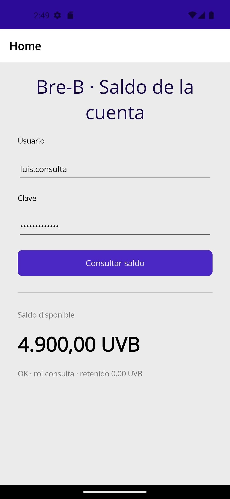

# Semana 12 — La app consumiendo la API con JWT, medida

**Fecha:** 17 de octubre de 2026
**Entorno:** Windows 11 · .NET SDK 10 · emulador `pixel_5_-_api_33` (imagen `google_apis_playstore`, x86_64) · API `Breb.Cuentas` en `http://0.0.0.0:5080` · PostgreSQL 5433 y RabbitMQ 5673 en Docker

Todas las cifras son de **una máquina**. Sirven para dar orden de magnitud, no para comparar equipos.

---

## 1. Lo que quedó verificado

El camino completo, de punta a punta, con la app instalada como la instalaría un estudiante:

| Paso | Evidencia |
|---|---|
| La app pide un token | `POST /token` en el log del servidor, traza `a7c657…` |
| La API lo emite | Rol `consulta` visible en la pantalla de la app |
| La app consulta el saldo con ese token | `GET /cuentas/{id}/saldo`, traza `952bf0…`, un segundo después |
| El número llega a la pantalla | **4.900,00 UVB** |
| Coincide con la fuente | El mismo `curl` desde el host devuelve `saldoDisponible: 4900.00` |



Las dos peticiones salieron del emulador con un segundo de diferencia y quedaron registradas con trazas distintas. No es una pantalla de maqueta: es el saldo que está en PostgreSQL.

---

## 2. ⚠️ El hallazgo de la semana: el APK de Debug no se puede instalar a mano

**Esto es lo que más riesgo tiene de arruinar el Evaluable 3.**

Se tomó el `.apk` recién compilado de `bin/Debug/net10.0-android/` y se instaló con `adb install`, que es exactamente lo que hace quien clona el repositorio o recibe el archivo por WhatsApp. El build había terminado con **0 errores y 0 advertencias**. La app se cierra al abrir, y en pantalla no dice por qué.

En `adb logcat` sí:

```
F monodroid: No assemblies found in
    '/data/user/0/com.companyname.breb.app/files/.__override__/x86_64'
    or '<unavailable>'. Assuming this is part of Fast Deployment. Exiting...
F monodroid: Abort at monodroid-glue.cc:757
F libc    : Fatal signal 6 (SIGABRT)
```

**La causa.** En Debug, .NET para Android usa *Fast Deployment*: para acortar el ciclo de compilar-y-probar, los ensamblados .NET **no se empaquetan dentro del APK**. Los copia aparte el propio `dotnet build -t:Run`, a una carpeta privada de la aplicación. El APK que queda en `bin/` está incompleto a propósito.

**Medido, mismo código, misma máquina:**

| Forma de compilar | Tamaño del APK | ¿Abre instalado a mano? |
|---|---|---|
| Debug, por defecto (Fast Deployment) | **13 MB** | **No** — aborta en `monodroid` |
| Debug con `-p:EmbedAssembliesIntoApk=true` | **81 MB** | **Sí** |

Seis veces más grande, y es la diferencia entre entregar algo que abre y algo que no.

### El síntoma que despista

Cuando la app aborta así, Android la reinicia una y otra vez hasta que decide matarla:

```
W ActivityManager: Process com.companyname.breb.app has crashed too many times,
                   killing! Reason: crashed quickly
```

Mientras tanto el sistema se ahoga y aparece **"Process system isn't responding"**. El diálogo habla del sistema, no de la app, y empuja a culpar al emulador. La carga del emulador durante el bucle llegó a **11,37**; cuatro minutos después de matar la app había bajado a **1,98**.

> **Regla para el Evaluable 3.** Si el squad entrega un `.apk`, tiene que venir de `-p:EmbedAssembliesIntoApk=true` o de un build de `Release` (que ya los embebe). Un APK de Debug suelto pesa poco, se instala sin quejarse, y no abre en la máquina de nadie más.

---

## 3. Cuánto tarda

### Compilación

| Operación | Tiempo | Confianza |
|---|---|---|
| Build Android Debug, por defecto | **593,7 s** | Media · una corrida, antes de agregar los dos paquetes |
| Build Android Debug con `EmbedAssembliesIntoApk=true` | **1 464,9 s** | Media · una corrida |

Las dos corridas no son estrictamente comparables: la segunda además restauró `CommunityToolkit.Mvvm` y `Microsoft.Extensions.Http`. Lo que sí se puede afirmar es el orden de magnitud: **embeber los ensamblados cuesta caro**, y conviene hacerlo una sola vez, al final, cuando ya se va a entregar.

### El emulador

| Operación | Tiempo |
|---|---|
| Arranque en frío (`-no-snapshot-load`) hasta `sys.boot_completed=1` | **215 s** |
| `adb reboot` hasta `sys.boot_completed=1` | **76 s** |
| Instalación del APK de 81 MB, emulador ya asentado | **10 s** |
| Instalación del APK de 13 MB, emulador recién arrancado | **67 s** |

> La inversión no es un error de medición: **el estado del emulador pesa más que el tamaño del archivo**. Un APK seis veces más grande se instaló casi siete veces más rápido, solo porque el sistema ya no estaba ocupado terminando de arrancar.

### Arranque de la app

| Corrida | `am start -W` |
|---|---|
| 1 | 14 441 ms |
| 2 | 13 512 ms |

Catorce segundos. En un teléfono real esto baja mucho; el emulador sobre este hardware es el caso desfavorable.

### Las dos llamadas a la API

Medido con `curl` desde el host, cinco corridas, con la API ya caliente:

| Corrida | `POST /token` | `GET /saldo` | Total |
|---|---|---|---|
| 1 | 423 ms | 218 ms | 642 ms |
| 2 | 413 ms | 218 ms | 631 ms |
| 3 | 430 ms | 378 ms | 808 ms |
| 4 | 608 ms | 224 ms | 832 ms |
| 5 | 440 ms | 411 ms | 851 ms |

**Mediana: 430 ms el token, 224 ms el saldo.** El token cuesta casi el doble porque firma el JWT; el saldo es una consulta indexada.

---

## 4. La trampa de método: el instrumento tiene que ser más rápido que lo medido

Se intentó medir cuánto pasa entre tocar el botón y ver el número, leyendo el árbol de la interfaz con `uiautomator dump` en un bucle.

**No sirve.** Una sola lectura del árbol cuesta **3 792 ms** en este emulador, y lo que se quería medir dura menos de un segundo. El instrumento es cuatro veces más lento que el fenómeno: cualquier número que saliera de ahí sería el tiempo de la herramienta, no el de la app.

Una primera medición de "toque → saldo en pantalla" dio **16 461 ms**, y esa cifra se descartó: incluía una espera fija de 12 s que el propio script había puesto. Queda anotada como lo que fue, un error de medición, no como un dato.

Lo que sí se puede afirmar con la evidencia disponible: las dos peticiones salieron con **un segundo de diferencia** según los sellos de tiempo del servidor, y el resto del retardo percibido es del emulador, no del código.

> Es la misma lección de la Semana 11 con el navegador: **antes de creerle a un número, hay que preguntarse qué fue lo que de verdad se midió.**

---

## 5. Reproducir esto

```bash
# 1. Infraestructura
docker start breb-postgres breb-rabbitmq

# 2. La API, escuchando en todas las interfaces
cd src/Breb.Cuentas
dotnet run --urls http://0.0.0.0:5080

# 3. El emulador, y esperar a que termine de arrancar de verdad
emulator -avd pixel_5_-_api_33 -no-snapshot-load
adb wait-for-device shell getprop sys.boot_completed   # hasta que diga 1

# 4. Solo entonces, la app
cd src/Breb.App
dotnet build -f net10.0-android -c Debug -p:EmbedAssembliesIntoApk=true
adb install -r bin/Debug/net10.0-android/com.companyname.breb.app-Signed.apk
```

**En ese orden, no en paralelo.** La Semana 11 midió un build que pasó de 300 s a 3 055 s por lanzar Docker, el emulador y la compilación al mismo tiempo.
